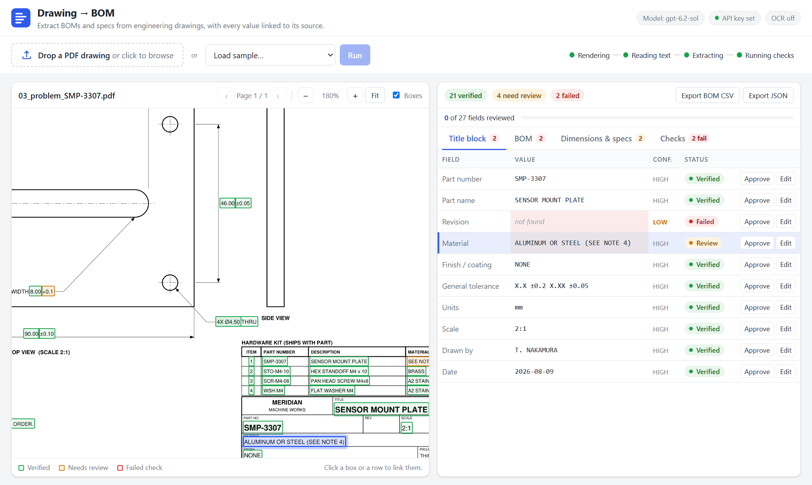
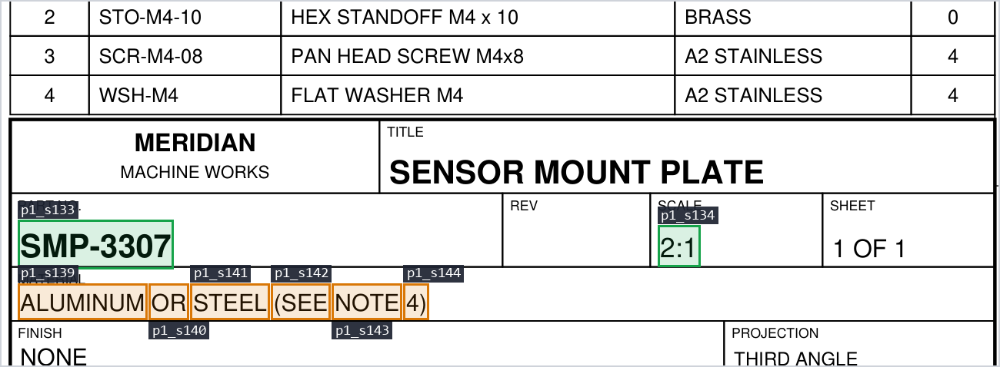
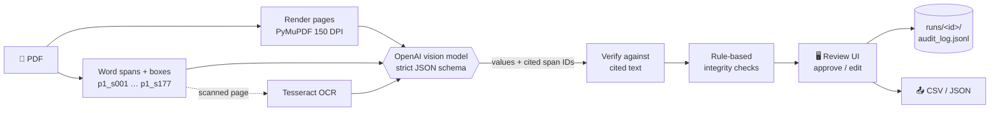
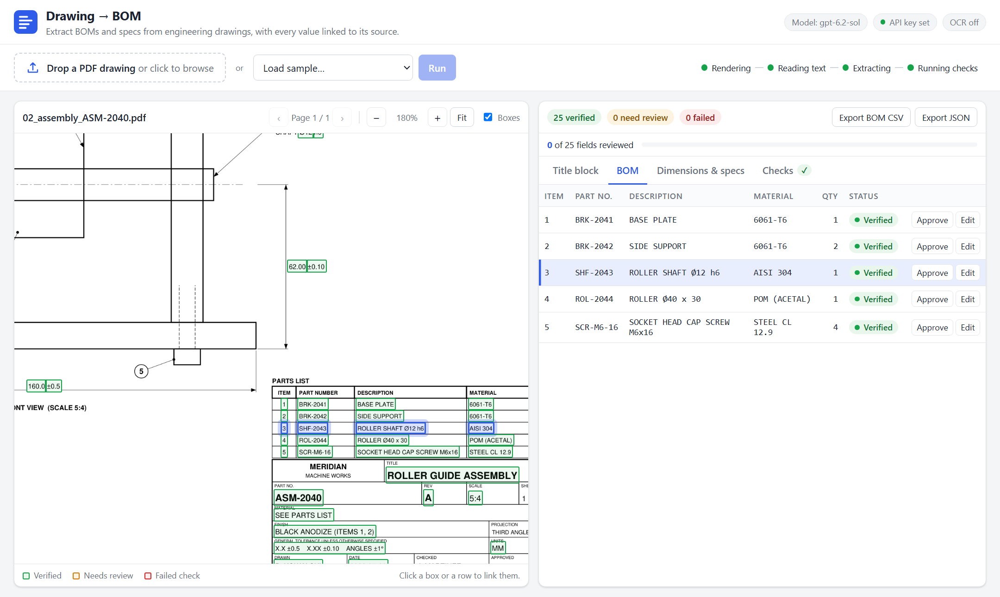
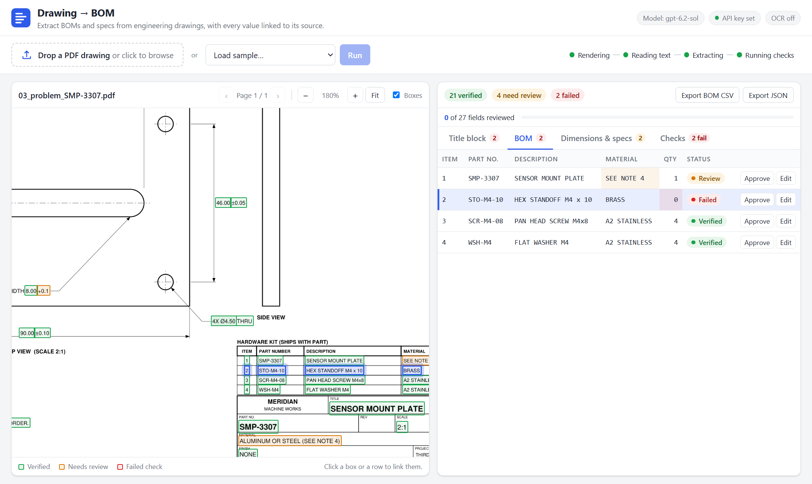
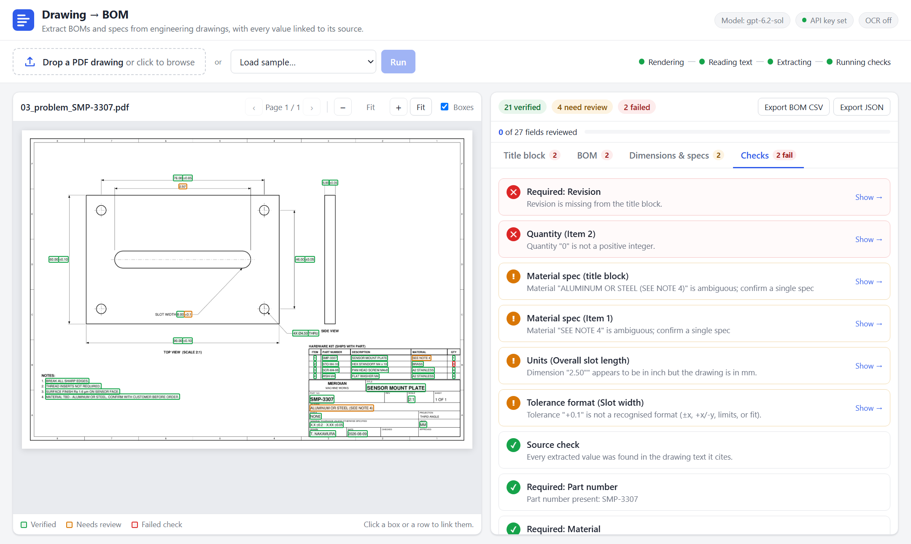
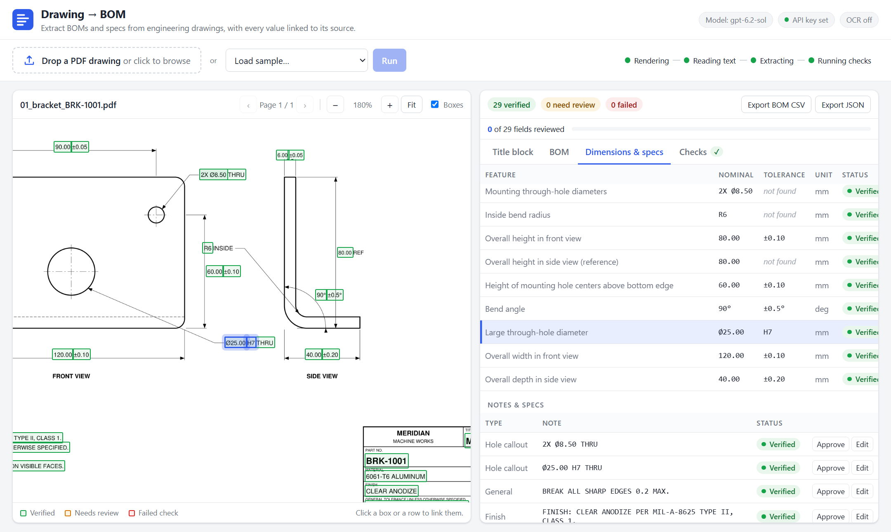
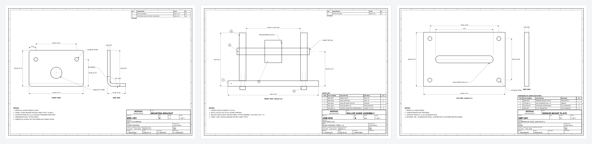

<div align="center">

# 📐 Drawing → BOM

### Turn engineering drawings into a verified Bill of Materials, with every value traced back to its exact spot on the drawing.




<sub>Click any extracted value and the app jumps to the exact words it came from. Amber = needs review, red = failed check.</sub>

</div>

---

## ✨ What it does

Upload a PDF drawing. In about 30 seconds you get:

| | |
|---|---|
| 🏷️ **Title block** | Part number, name, revision, material, finish, general tolerance, units, scale, drawn by, date |
| 📋 **Bill of Materials** | Item no., part number, description, material, quantity, read from the parts list |
| 📏 **Dimensions & specs** | Nominal, tolerance (±, limits, fits like `H7`), unit, plus notes: threads, finishes, heat treatment |
| 🔗 **Source links** | Every value is tied to exact boxes on the drawing. Click a row to see the box, or a box to see the row |
| 🚦 **Review flags** | Low confidence, unverifiable source or a failed rule turns the field amber or red, with the reason on hover |
| ✅ **Integrity checks** | Required fields, positive quantities, duplicate item numbers, parseable dimensions, unit consistency, material sanity |
| 🧾 **Audit trail** | Every step plus every human approve/edit (field, old value, new value, timestamp), saved per run |
| 📤 **Export** | BOM as CSV, or the full result + audit log as JSON |

---

## 🔗 The core idea: source linking that's actually exact

> Vision models are bad at coordinates, so **the model is never asked for a coordinate.**



1. **PyMuPDF** extracts every word on the page with its exact bounding box and gives it a stable ID such as `p1_s139`. Scanned pages fall back to Tesseract OCR with the same ID format.
2. The model receives **the page image *and* the span list** (ID + text + rough position).
3. Using **OpenAI Structured Outputs** (strict JSON schema), it returns each value **with the span IDs it read it from**.
4. The backend resolves those IDs to exact boxes and **checks that the value really appears in the cited text**. If the model cites an ID that doesn't exist, or a value that isn't there, the field is marked **unverified** and flagged for review.



---

## 🖼️ Screenshots

<table>
<tr>
<td width="50%"><br><b>Assembly BOM.</b> All 5 lines are source-verified. The selected row lights up its cells in the parts list.</td>
<td width="50%"><br><b>Failed check.</b> A quantity of <code>0</code> turns red, and only the offending cell is tinted.</td>
</tr>
<tr>
<td width="50%"><br><b>Checks tab.</b> Pass / warn / fail with plain-English reasons. Click <i>Show →</i> to jump to the field.</td>
<td width="50%"><br><b>Dimensions & specs.</b> Tolerances, fits and notes, each one clickable back to the drawing.</td>
</tr>
</table>

---

## 📊 Results on the bundled samples

Real runs against `gpt-6.2-sol`:



| Sample | What's on it | Result |
|---|---|---|
| `01_bracket_BRK-1001.pdf` | Single part, 6061-T6, 12 toleranced dims, `Ø25.00 H7` fit, anodize note, revision table | 🟢 **29 / 29 verified** · 0 warnings · ~36 s |
| `02_assembly_ASM-2040.pdf` | Assembly, 5-line parts list, balloons, `SEE PARTS LIST` material | 🟢 **25 / 25 verified** · BOM fully source-linked · ~33 s |
| `03_problem_SMP-3307.pdf` | Planted problems | 🔴 Blank revision · 🔴 qty `0` · 🟠 `ALUMINUM OR STEEL` · 🟠 inch dim on a mm drawing · 🟠 one-sided tol `+0.1` · ~29 s |

On sample 3, every planted problem was caught. Every extracted value on all three drawings matched its cited source text.

---

## 🚀 Quick start

```powershell
git clone https://github.com/hammadfarooq-ai/drawing-to-bom-demo.git
cd drawing-to-bom-demo
python -m venv .venv
.venv\Scripts\activate          # macOS/Linux: source .venv/bin/activate
pip install -r requirements.txt
copy .env.example .env          # macOS/Linux: cp .env.example .env
```

Put your key in **`.env`** (not `.env.example`):

```ini
OPENAI_API_KEY=sk-...
OPENAI_MODEL=gpt-6.2-sol        # or gpt-6.2-astra (most accurate) / gpt-6-luna (cheapest)
```

Run:

```powershell
python -m uvicorn app.main:app --port 8000
```

Open **http://localhost:8000**, pick a sample, and hit **Run**, or drag any PDF onto the page.

> **Optional:** install [Tesseract](https://github.com/tesseract-ocr/tesseract) for scanned drawings. Without it, vector PDFs work normally and scanned pages show a clear warning instead of crashing.

**Bring your own drawings:** drop any public engineering drawing PDF into `samples/` and it shows up in the dropdown. To regenerate the bundled samples, run `python scripts/make_samples.py`.

---

## 🚦 How a field gets its colour

| Status | When |
|---|---|
| 🟢 **Verified** | Value found in its cited spans, confidence high or medium, no failing rule |
| 🟠 **Needs review** | Low confidence · cited span missing or text mismatch · a *warning* rule (ambiguous material, odd tolerance format, unit mismatch) |
| 🔴 **Failed check** | A *failing* rule: missing required field, quantity ≤ 0 or non-integer, duplicate item number, unparseable dimension |

A dimension with no tolerance of its own stays green, because the general tolerance applies. Human edits skip the source check but **still go through the rules**, so typing `0` again keeps the row red.

<details>
<summary><b>All integrity checks</b></summary>

| Check | Result |
|---|---|
| Source check: every non-null value appears in its cited spans (normalized: case, whitespace, `Ø/∅`, `±/+/-`, dashes) | warn |
| Required: `part_number`, `material`, `revision`, `units` | fail |
| Quantity is a positive integer | fail |
| Duplicate BOM item numbers | fail |
| Dimension nominal parses as a number (`2X Ø8.50`, `R6`, `M6x1.0`, `90°`, `1/4`…) | fail |
| Tolerance format: `±x`, `+x/-y`, limits `a/b`, fits `H7` `h6` `H7/g6`, `max/min` | warn |
| Dimension units consistent with the drawing's units | warn |
| Material looks like a real spec (keyword list) and isn't ambiguous (`OR`, `TBD`, `SEE NOTE`…) | warn |
| `SEE PARTS LIST` in the title block passes only if every BOM line has a material | warn |

</details>

---

## 🧾 Audit trail

Every run gets its own folder:

```
runs/20261122-181014_03_problem_SMP-3307/
├── 03_problem_SMP-3307.pdf      original upload
├── pages/page_1.png             rendered pages
├── spans.json                   every word + box + ID
├── model_response_raw.json      exactly what the model returned
├── bom.json                     final result incl. reviews
├── checks.json                  check results
└── audit_log.jsonl              every step + every human action
```

```json
{"ts": "2026-11-22T18:12:40+05:00", "event": "human_edit", "row": "Item 2", "field": "quantity", "old_value": "0", "new_value": "4"}
```

Reopen any past run, or deep-link to a specific finding:
`http://localhost:8000/?run=<run_id>&select=bom.1` · `&tab=checks`

---

## 🛡️ Built to demo reliably

- **Never a stack trace in the UI.** Missing key, bad PDF, timeouts and junk model output all become one readable sentence.
- **Retries with backoff.** Up to 3 attempts (2 s, 4 s) on timeouts, 5xx, rate limits and malformed or truncated output. Auth, quota and model-not-found errors fail fast with a fix-it message.
- **Strict schema.** Every object is closed and every field is required/nullable, so responses always parse.
- **Offline tests.** 67 pytest tests, **zero API calls**. `tests/fake_model.py` builds model-shaped answers from real span IDs in the sample PDFs.

```powershell
python -m pytest -q
```

---

## 🗂️ Project layout

```
app/
├── main.py         FastAPI routes: runs, status polling, review, export
├── pipeline.py     render → spans → extract → verify → checks → save
├── pdf_utils.py    PyMuPDF rendering, word spans with IDs, OCR fallback
├── extract.py      OpenAI Responses API + strict JSON schema, prompt, retries
├── checks.py       source verification, parsers, integrity rules, status logic
└── audit.py        run folders + JSONL audit log
static/             index.html · app.js · styles.css (vanilla, no build step)
scripts/            make_samples.py: reportlab generator for vector drawings
samples/            3 synthetic drawings (works offline)
tests/              pytest suite + fake model fixture
docs/images/        README visuals
```

<details>
<summary><b>Design decisions</b></summary>

- **Responses API with `text.format: json_schema` (strict).** This is what OpenAI's current docs recommend for GPT-6-era models.
- **Units:** the model may normalize units to `mm`/`inch`. The matcher accepts `MM`, `MILLIMETERS` and `METRIC` as sources for `mm`. All other values must be copied verbatim.
- **Review counter** counts rows: a title-block field is one row, and a BOM line is one row with five fields. Approving a red row is allowed, and the log records the status at approval time.
- **Single-part drawings** export as one BOM line in the CSV.
- **Limits:** the first 5 pages are processed, uploads are capped at 25 MB, and pages render at 150 DPI.
- **Job state** lives in memory and results live on disk, so past runs survive a restart.

</details>

---

## ⚠️ Limitations

- **Not a replacement for engineer review.** It does not interpret GD&T frames, datum schemes, stack-ups, or fits beyond checking their format.
- **Accuracy depends on drawing quality.** Clean vector PDFs work best. On scanned drawings, boxes are only as good as the OCR, and rotated or dense text may be missed.
- **Verification proves a value *appears* in the cited text, not that it landed in the right field.** For example, *drawn by* swapped with *checked by* would still verify. That's what human review is for.
- The material check is a keyword list, not a materials database.

---

<div align="center">
<sub>Built with FastAPI · PyMuPDF · OpenAI Structured Outputs · vanilla JS</sub>
</div>
